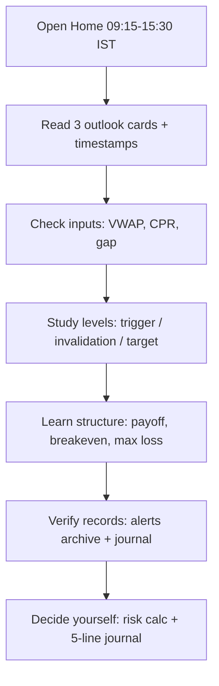

# How to use TradingAI.in — narrative + animated guide

Live animated page: **https://tradingai.in/how-to-use-website.html** (60-second story, play/pause, reduced-motion safe).
This file is the text narrative for GitHub readers. Educational only — not investment advice.

## The story (Ravi, 09:20 IST)

Ravi opens TradingAI.in during market hours (09:15–15:30 IST) and follows the same six
stops every day: **Outlook → Inputs → Levels → Learn → Records → Decide.**

1. **Outlook.** Home shows three cards — NIFTY, BANKNIFTY, India VIX — each with an IST
   timestamp. Outside hours they show end-of-day context. Start: `/`.
2. **Inputs.** Each card lists observed inputs — vs VWAP, CPR position, gap — and what
   would change it. Rulebook: `/methodology.html`, `/signal-flow.html`.
3. **Levels.** Index pages show reference trigger, invalidation and target — the same
   numbers behind every Telegram alert. Study, don't chase: `/indices/nifty.html`.
4. **Learn.** Spread guides explain payoff, breakeven and capped loss with assumed
   premiums (not live prices): `/bull-put-spread.html`, `/bear-call-spread.html`.
5. **Records.** Every alert is kept win or lose: `/alerts.html` (archive) and
   `/paper.html` (observations journal). Check adverse days first.
6. **Decide.** Size with `/tools.html#risk`, log five lines in `/tools.html#journal`.
   Your call — always. Education, not advice.

## Flowchart (rendered on GitHub)

## One CPR morning (frames — same as website Animation 2)

- Frame 1: Yesterday settles. Blue band TC/BC from yesterday's high/low/close only.
- Frame 2: 09:15 flat open inside the band. Information, not evidence.
- Frame 3: Pokes touch the edge; candles close back inside. Wait.
- Frame 4: Wicks ≠ closes. Invalidation line already written down.
- Frame 5: A full 5-minute candle closes above TC — evaluated observation.
- Frame 6: Close back below TC ends the read. Risk sized from that line.
- Frame 7: 15:10 reference close ends bookkeeping win or lose.

Animated SVG version: `docs/website-tour.svg` (SMIL; plays on GitHub blob view and
raw). Static fallback text is embedded in the SVG for readers without animation.

## Five-line journal (copy daily)

1. Date + CPR width (narrow / normal / wide).
2. Morning map: TC / Pivot / BC / S1 / R1 / high / low.
3. Gap in one sentence.
4. First qualifying close — or "no classified session".
5. Outcome vs the predefined line + one lesson.

## Links

- Animated guide: https://tradingai.in/how-to-use-website.html
- CPR routine: https://tradingai.in/how-to-use-cpr-intraday.html
- Methodology: https://tradingai.in/methodology.html
- Signal flow: https://tradingai.in/signal-flow.html
- Learn: https://tradingai.in/learn.html · Tools: https://tradingai.in/tools.html
