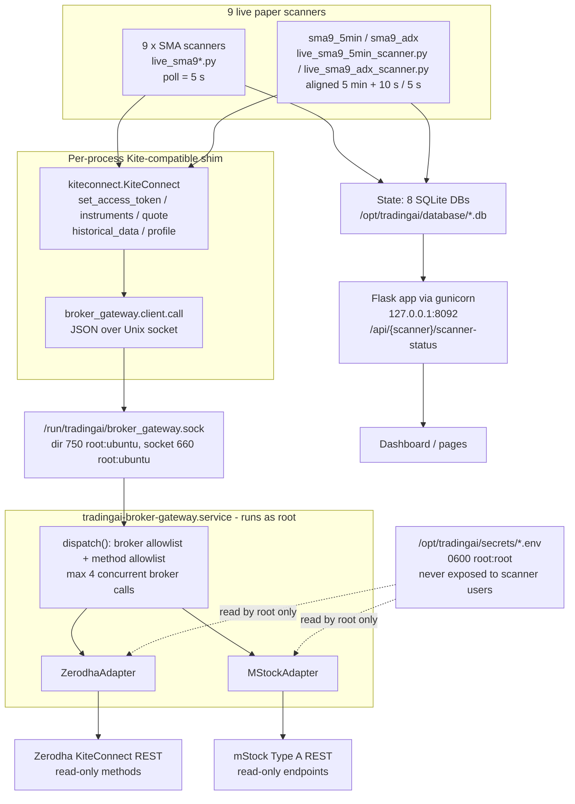
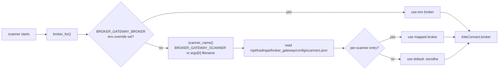
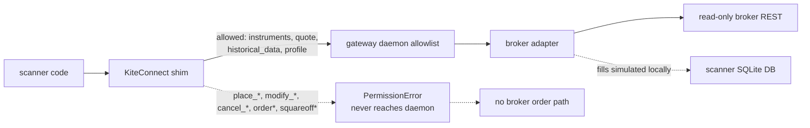
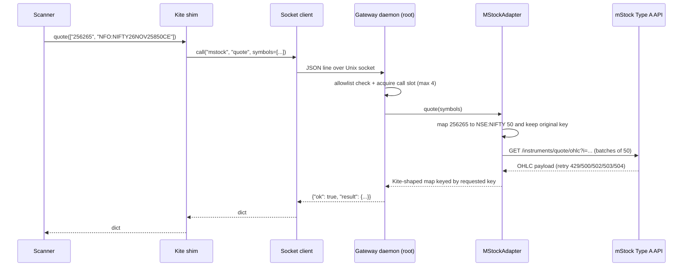
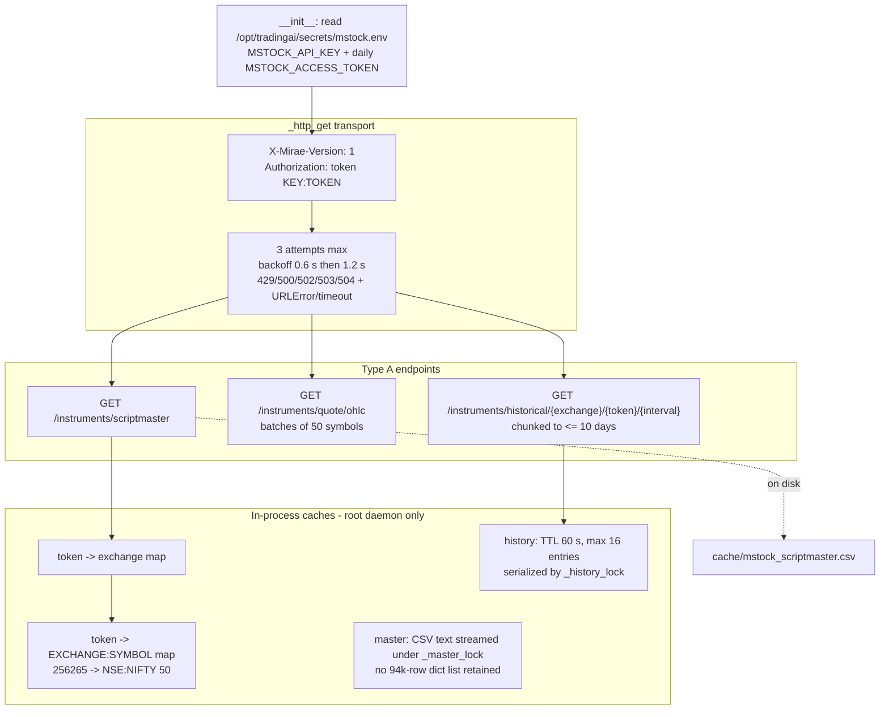

# Scanner & Broker Connectivity Architecture

This document describes how the eight live paper scanners reach a broker without
any scanner source changes. Every scanner uses the same read-only gateway path:
broker choice is a config/CLI setting, never a code change. The broker gateway is the only component that
holds broker credentials; scanners see a read-only, Kite-shaped API.

## Design goals

- **Paper only.** No `place_order`, `order_id`, or broker write path exists.
- **Broker = config.** Switching brokers is a CLI command plus a scanner restart.
- **Secrets stay root-only.** Scanner users never read broker credential files.
- **Stable identities.** Scanner names, DBs, services, API routes, 5 s polling,
  09:00 IST start, 09:20–15:15 entries, 09:00–09:15 warm-up, ATR-only exits and
  A+B entry gating are unchanged.

## 1. End-to-end view



## 2. Scanner inventory

| Alias (CLI) | Script | systemd service | Run user | State file | API status route |
|---|---|---|---|---|---|
| `sma9` | `live_sma9_scanner.py` | `tradingai-sma9-scanner` | `sma9` | `/opt/tradingai/database/sma9.db` | `/api/sma9/scanner-status` |
| `sma9_5min` | `live_sma9_5min_scanner.py` | `tradingai-sma9-5min-scanner` (deployed) | `sma95min` (deployed) | `/opt/tradingai/database/sma9_5min.db` | `/api/sma9-5min/scanner-status` (deployed) |
| `sma9_adx` | `live_sma9_adx_scanner.py` | `tradingai-sma9-adx-scanner` (deployed) | `sma9adx` (deployed) | `/opt/tradingai/database/sma9_adx.db` | `/api/sma9-adx/scanner-status` (deployed) |
| `sma9_atr` | `live_sma9_atr_scanner.py` | `tradingai-sma9-atr-scanner` | `sma9` | `/opt/tradingai/database/sma9_atr.db` | `/api/sma9-atr/scanner-status` |
| `sma9_high` | `live_sma9_high_scanner.py` | `tradingai-sma9-high-scanner` | `sma9high` | `/opt/tradingai/database/sma9_high.db` | `/api/sma9-high/scanner-status` |
| `sma9_trail` | `live_sma9_trail_scanner.py` | `tradingai-sma9_trail-scanner` | `sma9trail` | `/opt/tradingai/database/sma9_trail.db` | `/api/sma9-trail/scanner-status` |
| `sma9_high_trail` | `live_sma9_high_trail_scanner.py` | `tradingai-sma9_high_trail-scanner` | `sma9trailhigh` | `/opt/tradingai/database/sma9_high_trail.db` | `/api/sma9-high-trail/scanner-status` |

All seven deployed scanners resolve to broker `mstock`. The seven SMA routes are served
by `app.api.app:app` under gunicorn.

## 3. How a scanner picks its broker

Broker resolution happens once, when `KiteConnect(...)` is constructed. It is
config/env only — no scanner code participates.



Selection commands:

```bash
sudo broker-gateway adapters
sudo broker-gateway status
sudo broker-gateway use --scanner sma9_atr --broker mstock
sudo systemctl restart tradingai-sma9-atr-scanner
```

Only the restarted scanner picks up the change; the other six keep running.

## 4. The read-only boundary



- The shim's `__getattr__` rejects write-prefixed attributes immediately.
- The daemon independently enforces `METHODS = {instruments, quote,
  historical_data, profile}` and a broker allowlist, so a direct socket client
  cannot widen the surface either.
- `BrokerAdapter` is an ABC with only the three data methods plus `profile()`.
- The daemon strips any quote entry whose `last_price` is missing, non-numeric,
  non-finite or `<= 0` before returning it (`_sanitize_quote`). Scanners do
  `float(quote[symbol]["last_price"])` inside a try/except, so a stripped key
  becomes "LTP unavailable" and no paper entry or ATR stop exit is created from
  a bogus zero/negative tick. This is enforced at the broker boundary for every
  adapter, so switching brokers never changes scanner code.
- Every trade remains simulated in the scanner's own SQLite database.

## 5. Lifecycle of one quote call



## 6. mStock adapter internals



Notable mappings and guards:

- `OPTIDX`/`CE`/`PE` and `OPT*` segments map to `NFO-OPT`; futures to `NFO-FUT`.
- Numeric quote tokens are translated for the broker but results are keyed by the
  original requested key, so scanner lookups keep working.
- Raw history requests over 10 days return HTTP 400 from mStock, so the adapter
  chunks ranges and merges candles.
- The 60-second history cache plus the shared lock prevents eight scanners from
  refetching the same option candles concurrently.

## 7. Deployment map

| Layer | Location | Owner / mode |
|---|---|---|
| Source of truth | `/Users/satya/tradingai_sync` | repo on `feature/zerodha-paper-trading` |
| Gateway code | `/opt/tradingai/broker_gateway/` | root, 644 |
| Gateway config | `config/scanners.json` | root, 644; no secrets |
| Gateway cache | `cache/mstock_scriptmaster.csv` | root:ubuntu, 750 dir |
| Secrets | `/opt/tradingai/secrets/*.env` | root, 600 |
| Daemon unit | `/etc/systemd/system/tradingai-broker-gateway.service` | root, runs as root |
| CLI | `/usr/local/sbin/broker-gateway` | root, 700 |
| Python bootstrap | `broker_gateway.pth` in site-packages | puts shim on every Python path |
| Scanner services | `/etc/systemd/system/tradingai-*-scanner.service` | dedicated users, group `ubuntu` |
| Logs | `/opt/tradingai/logs/*.log` | written by each service |
| API | gunicorn `app.api.app:app` on `127.0.0.1:8092` | Flask, 2 workers; `BROKER_GATEWAY_SCANNER=api` so its Kite-shaped market data uses the `api` broker mapping in `scanners.json` (currently `mstock`) |

The Flask API's live quote/candle provider imports the same read-only Kite shim
as the scanners. Its unit sets `BROKER_GATEWAY_SCANNER=api`, and `scanners.json`
has an explicit `api` entry. Changing that mapping with
`broker-gateway use --scanner api --broker <name>` changes API market data too;
no API code change or restart is needed for a broker switch. Scanner-status
routes remain DB-backed and broker-independent.

Zerodha token exchange (`app/zerodha/token_exchange.py`, run as root by
`refresh_token.sh`) deliberately uses `broker_gateway.real_kite.load_real_kite_connect()`
instead of the shim: `generate_session()` is an authentication operation, not a
read-only market-data call, and is never exposed over the gateway socket.
`zerodha_credentials.persist_access_token()` keeps the canonical file `0600
root:root` after every refresh.

Installer: `scripts/ops/install_broker_gateway.sh` installs code, config, CLI,
systemd unit and the `.pth` bootstrap. It does **not** restart scanners.

Secret lifecycle (no secret is ever passed as an argument or logged):

```bash
sudo /usr/local/sbin/rotate_mstock_key.sh       # hidden prompt, local key replacement only
sudo /usr/local/sbin/mstock_session.py --mode totp   # daily access token, OTP/TOTP never stored
sudo /usr/local/sbin/mstock_session.py --check  # verify stored token
```

## 8. Token lifecycle and live-market readiness

mStock Type A issues **daily** access tokens. `mstock_session.py` writes them to
`/opt/tradingai/secrets/mstock.env` with an atomic `os.replace`. The stored
`MSTOCK_REFRESH_TOKEN` is not used by any current automation, so a fresh session
must be created interactively before each trading day:

```bash
sudo /usr/local/sbin/mstock_session.py --mode totp   # or --mode otp
sudo /usr/local/sbin/mstock_session.py --check       # confirm before market open
```

Freshness is enforced by the gateway for **every** broker, not just mStock. Each
adapter exposes three hooks:

- `credential_signature()` — the current `(mtime, size)` of its credential file;
- `refresh_credentials_if_changed()` — adopt a refreshed token on disk;
- `validate_credentials()` — a lightweight broker call that proves the token works.

On every dispatch the daemon adopts any credential change, then validates the
token (cached for 300 s per broker, invalidated when the signature changes). A
stale or rejected token is refused with a clear error before any data call is
made, so a scanner never silently trades on an expired token. This applies to
`mstock` (`/opt/tradingai/secrets/mstock.env`) and `zerodha`
(`/opt/tradingai/secrets/zerodha.env`) and to any future adapter that implements
the hooks. An empty or partial refresh is ignored and the last working
credentials are retained.

Zerodha's real secret file is `0600 root:root` and is readable only by the root
gateway daemon and root-run refresh tools; the gateway unit sets
`ZERODHA_CREDENTIALS_FILE` to that path. `/opt/tradingai/.env.zerodha` is now a
`0640 root:ubuntu` placeholder containing the same key names with dummy values.
The scanners may still read that placeholder (their source is unchanged); the
Kite shim ignores the values and routes all calls through the gateway. The shared
`zerodha_credentials.load_credentials()` prefers the root-only file and falls
back to the placeholder only for non-root callers such as the Flask API.

`MStockAdapter` re-reads its secret whenever the signature changes and `_headers()`
checks on every HTTP request, so a pre-market refresh becomes active on the next
broker call **without restarting the daemon**. `ZerodhaAdapter` rebuilds its
`KiteConnect` client the same way, so the Zerodha `refresh_token.sh` also takes
effect without a daemon restart.

There is no mStock refresh timer. The existing `tradingai-token-check.timer`
(08:45 Mon–Fri IST) is a read-only **Zerodha** check and does not refresh or
restart anything; it is not part of the mStock path.

Broker selection itself is separate from tokens:

- `config/scanners.json` has `default: zerodha` but all eight scanners carry an
  explicit `mstock` entry, so every running scanner uses mstock.
- Any scanner key not present in that mapping would fall back to the Zerodha
  default. Set `default` to `mstock` if that fallback is not wanted.

## 9. Failure modes and mitigations

| Failure | Mitigation |
|---|---|
| mStock HTTP 500/429 on quote | 3 attempts with 0.6 s / 1.2 s backoff |
| mStock `Something went wrong. Please try again.` | transient-message retry in `_get_json` |
| >10 day history request | 10-day chunking and merge |
| Duplicate history fetches from 8 scanners | 60 s cache + `_history_lock` serialization |
| Memory pressure / OOM | 4-call concurrency cap; scriptmaster CSV streamed under `_master_lock`, only compact token maps retained; 16-entry history cache |
| Socket `Connection refused` / `BrokenPipe` during gateway restart | systemd `Restart=always`; transient scanner errors are skipped on next 5 s poll |
| Daily mStock token expires overnight | Run `mstock_session.py --mode totp` before market open; daemon adopts the new token on the next call |
| Stale token for the selected broker | Gateway validates before every data call and refuses stale tokens with a clear error; refresh that broker's token |
| Failed token validation hammering the broker | Short 30 s negative freshness cache (`BROKER_GATEWAY_FRESH_NEG_TTL`) fails closed without repeated profile calls; a credential-signature change bypasses it immediately |
| Credential refresh race (TOCTOU) | Adapters stamp the file signature observed *before* the read, so a concurrent atomic rewrite cannot pair old credentials with a newer stamp and be skipped forever |
| 08:45 pre-market check only covered Zerodha | `premarket_token_check.sh` now checks the effective mStock broker first and reports both brokers in `token_status.txt` |
| Stale Zerodha token | Refresh that scanner's token before switching back; avoid fleet-wide refresh |
| Broker write attempted | Shim `PermissionError` + daemon method allowlist |
| Zero/negative/NULL broker quote | Gateway removes `last_price`; scanner treats it as "LTP unavailable" and skips entry/exit for that poll |
| Stale quote during live hours | When the broker publishes `last_trade_time`, gateway computes `age_seconds` and strips `last_price` above `BROKER_GATEWAY_QUOTE_MAX_AGE` (300 s). mStock's OHLC endpoint has no timestamp, so live-fetched quotes are marked `age_seconds=0` and pass through |
| Trailing stop resets on restart | Every scanner persists `hwm`/`stop` immediately after a ratchet; `sma9`/`sma9_high` gained idempotent `hwm`, `stop`, `be_locked` columns and load them back on restore |
| Crash between trade insert and open-position delete | `save_trade()` now inserts the closed trade and deletes `<prefix>_open_positions` in one SQLite transaction; paired `delete_open_position()` calls removed |
| World-writable SQLite DBs | `/opt/tradingai/database` is `2775 root:ubuntu`; DB files `0660 <owner>:ubuntu`; root `ExecStartPre` narrowed from `chmod 0666` to `0660` |

## 10. Extending to another broker

1. Add `broker_gateway/adapters/<name>.py` implementing `instruments`, `quote`,
   `historical_data` (optionally `profile`) on `BrokerAdapter`.
2. Register it in `broker_gateway/adapters/__init__.py`.
3. Store credentials in `/opt/tradingai/secrets/<name>.env` (`0600 root:root`).
4. Run `sudo broker-gateway probe --broker <name>`.
5. Select per scanner with `sudo broker-gateway use --scanner <alias> --broker <name>`
   and restart only that service.

No scanner file changes are needed.

## 11. Verified production state (2026-11-21)

- All 8 scanners configured to `mstock`; default remains `zerodha`.
- All 9 services (gateway + 8 scanners) active with zero systemd restarts.
- Gateway log clean; `probe --broker mstock` reports profile ok, 94089 NFO
  instruments, NIFTY quote ok.
- Seven SMA APIs: `IDLE_MARKET_CLOSED`, `poll=5`, fresh scan ages, errors only
  `['weekend']`.
- Database directory `2775 root:ubuntu`, all DB files `0660` with no
  world-writable SQLite files.
- Gateway price guard verified: zero/negative/non-finite `last_price` values are
  removed from quote responses before scanners see them.
- Memory: after a full service restart with warm instrument caches, ~700 MB
  used of 956 MB with swap available and PSI avg10 ~1%; the acute pressure
  caused by simultaneous restarts subsides within seconds.
- `mstock_session.py --check` reports `session: valid`; the stored token was
  written at 10:10 IST and the daemon started at 11:23 IST, so the current token
  is the one in use.
- Token auto-reload verified with dummy credentials: an atomic secret-file
  replacement is adopted on the next call, and an invalid refresh is ignored.
- Gateway freshness guard verified end-to-end: a `profile` call through the
  socket succeeds for mstock and is refused for zerodha with
  `zerodha token is stale or invalid; refresh it before trading: ...`.
- Negative freshness cache, credential-stamp ordering and both-broker premarket
  check covered by `tests/test_broker_gateway_freshness.py`; manual premarket
  run reports `MSTOCK_VALID | ZERODHA_INVALID` as expected.
- Scanner state durability covered by `tests/test_scanner_state_durability.py`
  (22 tests: atomic trade insert + open-position delete with rollback on
  failure, and HWM/stop surviving save/reload across all 7 scanners). Quote
  freshness covered by `tests/test_broker_gateway_quote_freshness.py`.
  Deployed and verified: all 10 services active, `sma9`/`sma9_high` columns
  migrated, no open positions duplicated, `/api/quote/NIFTY` `LIVE` with
  `age_seconds=0`.

Live-market checks (09:00 IST start, entry window, warm-up, ATR exits, A+B gating,
no broker orders) still require a trading session. The current daily token must
be regenerated before Monday's session; the daemon will pick it up automatically.
