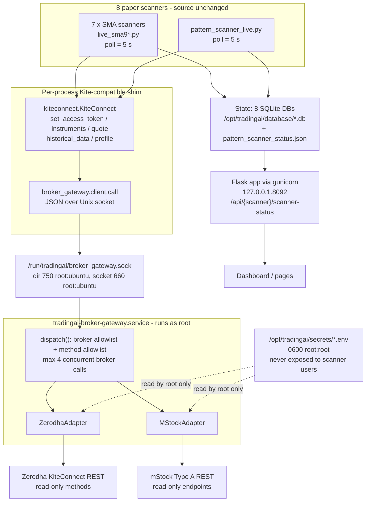
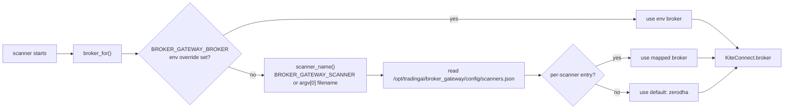
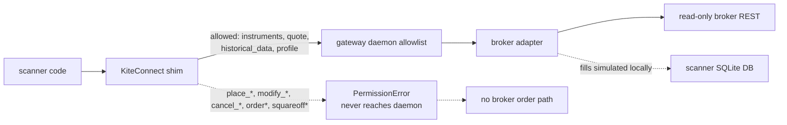
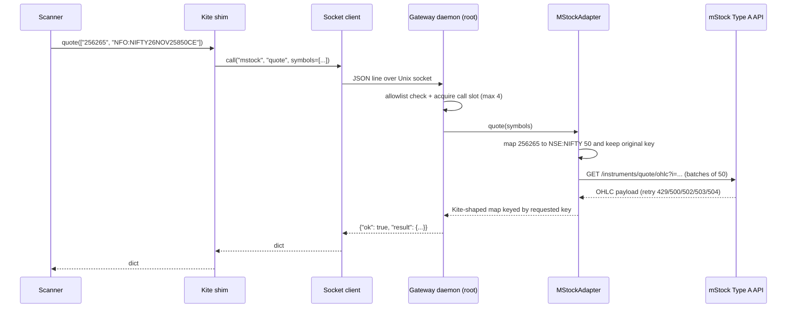
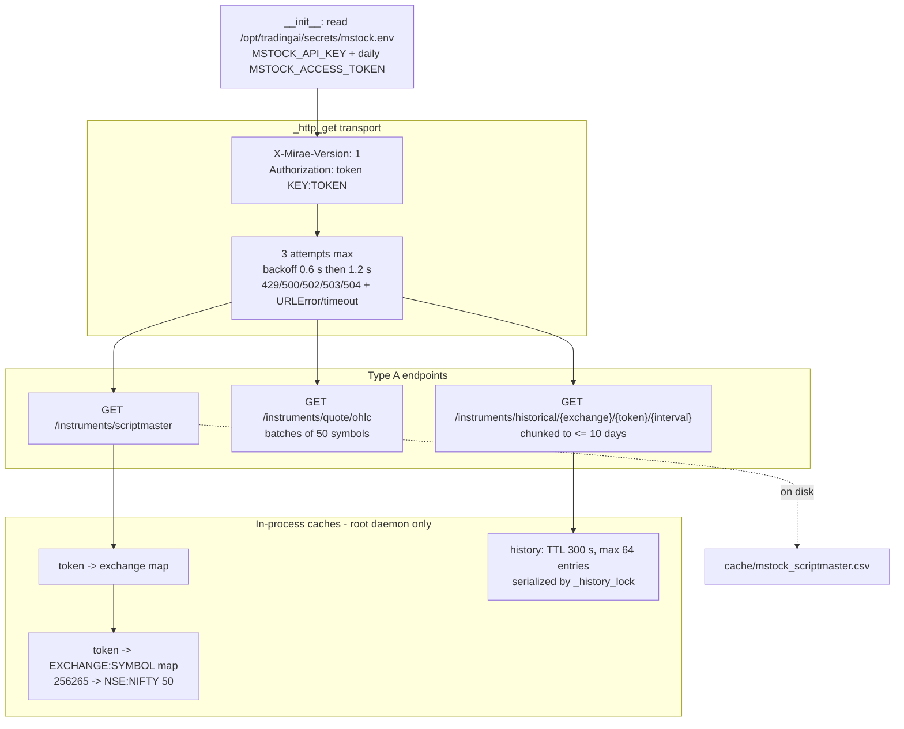

# Scanner & Broker Connectivity Architecture

This document describes how the eight live paper scanners reach a broker without
any scanner source changes. The broker gateway is the only component that holds
broker credentials; scanners see a read-only, Kite-shaped API.

## Design goals

- **Paper only.** No `place_order`, `order_id`, or broker write path exists.
- **Broker = config.** Switching brokers is a CLI command plus a scanner restart.
- **Secrets stay root-only.** Scanner users never read broker credential files.
- **Stable identities.** Scanner names, DBs, services, API routes, 5 s polling,
  09:00 IST start, 09:20–15:15 entries, 09:00–09:15 warm-up, ATR-only exits and
  A+B entry gating are unchanged.

## 1. End-to-end view



## 2. Scanner inventory

| Alias (CLI) | Script | systemd service | Run user | State file | API status route |
|---|---|---|---|---|---|
| `sma9` | `live_sma9_scanner.py` | `tradingai-sma9-scanner` | `sma9` | `/opt/tradingai/database/sma9.db` | `/api/sma9/scanner-status` |
| `sma9_atr` | `live_sma9_atr_scanner.py` | `tradingai-sma9-atr-scanner` | `sma9` | `/opt/tradingai/database/sma9_atr.db` | `/api/sma9-atr/scanner-status` |
| `sma9_high` | `live_sma9_high_scanner.py` | `tradingai-sma9-high-scanner` | `sma9high` | `/opt/tradingai/database/sma9_high.db` | `/api/sma9-high/scanner-status` |
| `sma9_trail` | `live_sma9_trail_scanner.py` | `tradingai-sma9_trail-scanner` | `sma9trail` | `/opt/tradingai/database/sma9_trail.db` | `/api/sma9-trail/scanner-status` |
| `sma9_high_trail` | `live_sma9_high_trail_scanner.py` | `tradingai-sma9_high_trail-scanner` | `sma9trailhigh` | `/opt/tradingai/database/sma9_high_trail.db` | `/api/sma9-high-trail/scanner-status` |
| `sma9_5s_atr` | `live_sma9_5s_atr_scanner.py` | `tradingai-sma9-5s-atr-scanner` | `sma95satr` | `/opt/tradingai/database/sma9_5s_atr.db` | `/api/sma9-5s-atr/scanner-status` |
| `sma9_1min_poll` | `live_sma9_1min_poll_scanner.py` | `tradingai-sma9-1min-poll-scanner` | `sma91m` | `/opt/tradingai/database/sma9_1min_poll.db` | `/api/sma9-1min-poll/scanner-status` |
| `pattern` | `pattern_scanner_live.py` | `pattern-scanner-live` | `ubuntu` | `/opt/tradingai/data/pattern_scanner_status.json` | no dedicated route; dashboard reads JSON |

All eight currently resolve to broker `mstock`. The seven SMA routes are served
by `app.api.app:app` under gunicorn; the pattern scanner publishes a JSON status
file that is refreshed every 5 s.

## 3. How a scanner picks its broker

Broker resolution happens once, when `KiteConnect(...)` is constructed. It is
config/env only — no scanner code participates.



Selection commands:

```bash
sudo broker-gateway adapters
sudo broker-gateway status
sudo broker-gateway use --scanner sma9_1min_poll --broker mstock
sudo systemctl restart tradingai-sma9-1min-poll-scanner
```

Only the restarted scanner picks up the change; the other seven keep running.

## 4. The read-only boundary



- The shim's `__getattr__` rejects write-prefixed attributes immediately.
- The daemon independently enforces `METHODS = {instruments, quote,
  historical_data, profile}` and a broker allowlist, so a direct socket client
  cannot widen the surface either.
- `BrokerAdapter` is an ABC with only the three data methods plus `profile()`.
- Every trade remains simulated in the scanner's own SQLite database.

## 5. Lifecycle of one quote call



## 6. mStock adapter internals



Notable mappings and guards:

- `OPTIDX`/`CE`/`PE` and `OPT*` segments map to `NFO-OPT`; futures to `NFO-FUT`.
- Numeric quote tokens are translated for the broker but results are keyed by the
  original requested key, so scanner lookups keep working.
- Raw history requests over 10 days return HTTP 400 from mStock, so the adapter
  chunks ranges and merges candles.
- The 5-minute history cache plus the shared lock prevents eight scanners from
  refetching the same option candles concurrently.

## 7. Deployment map

| Layer | Location | Owner / mode |
|---|---|---|
| Source of truth | `/Users/satya/tradingai_sync` | repo on `feature/zerodha-paper-trading` |
| Gateway code | `/opt/tradingai/broker_gateway/` | root, 644 |
| Gateway config | `config/scanners.json` | root, 644; no secrets |
| Gateway cache | `cache/mstock_scriptmaster.csv` | root:ubuntu, 750 dir |
| Secrets | `/opt/tradingai/secrets/*.env` | root, 600 |
| Daemon unit | `/etc/systemd/system/tradingai-broker-gateway.service` | root, runs as root |
| CLI | `/usr/local/sbin/broker-gateway` | root, 700 |
| Python bootstrap | `broker_gateway.pth` in site-packages | puts shim on every Python path |
| Scanner services | `/etc/systemd/system/tradingai-*-scanner.service`, `pattern-scanner-live.service` | dedicated users, group `ubuntu` |
| Logs | `/opt/tradingai/logs/*.log` | written by each service |
| API | gunicorn `app.api.app:app` on `127.0.0.1:8092` | Flask, 2 workers |

Installer: `scripts/ops/install_broker_gateway.sh` installs code, config, CLI,
systemd unit and the `.pth` bootstrap. It does **not** restart scanners.

Secret lifecycle (no secret is ever passed as an argument or logged):

```bash
sudo /usr/local/sbin/rotate_mstock_key.sh       # hidden prompt, local key replacement only
sudo /usr/local/sbin/mstock_session.py --mode totp   # daily access token, OTP/TOTP never stored
sudo /usr/local/sbin/mstock_session.py --check  # verify stored token
```

## 8. Token lifecycle and live-market readiness

mStock Type A issues **daily** access tokens. `mstock_session.py` writes them to
`/opt/tradingai/secrets/mstock.env` with an atomic `os.replace`. The stored
`MSTOCK_REFRESH_TOKEN` is not used by any current automation, so a fresh session
must be created interactively before each trading day:

```bash
sudo /usr/local/sbin/mstock_session.py --mode totp   # or --mode otp
sudo /usr/local/sbin/mstock_session.py --check       # confirm before market open
```

The gateway daemon is long-running, so `MStockAdapter` re-reads the secret file
whenever its `(mtime, size)` signature changes. `_headers()` performs that check
on every HTTP request, so a pre-market token refresh becomes active on the next
broker call **without restarting the daemon**. An empty or partial refresh is
ignored and the previous working credentials are retained.

There is no mStock refresh timer. The existing `tradingai-token-check.timer`
(08:45 Mon–Fri IST) is a read-only **Zerodha** check and does not refresh or
restart anything; it is not part of the mStock path.

Broker selection itself is separate from tokens:

- `config/scanners.json` has `default: zerodha` but all eight scanners carry an
  explicit `mstock` entry, so every running scanner uses mstock.
- Any scanner key not present in that mapping would fall back to the Zerodha
  default. Set `default` to `mstock` if that fallback is not wanted.

## 9. Failure modes and mitigations

| Failure | Mitigation |
|---|---|
| mStock HTTP 500/429 on quote | 3 attempts with 0.6 s / 1.2 s backoff |
| mStock `Something went wrong. Please try again.` | transient-message retry in `_get_json` |
| >10 day history request | 10-day chunking and merge |
| Duplicate history fetches from 8 scanners | 300 s cache + `_history_lock` serialization |
| Memory pressure / OOM | 4-call concurrency cap; cached scriptmaster and candles |
| Socket `Connection refused` / `BrokenPipe` during gateway restart | systemd `Restart=always`; transient scanner errors are skipped on next 5 s poll |
| Daily mStock token expires overnight | Run `mstock_session.py --mode totp` before market open; daemon adopts the new token on the next call |
| Stale Zerodha token | Refresh that scanner's token before switching back; avoid fleet-wide refresh |
| Broker write attempted | Shim `PermissionError` + daemon method allowlist |

## 10. Extending to another broker

1. Add `broker_gateway/adapters/<name>.py` implementing `instruments`, `quote`,
   `historical_data` (optionally `profile`) on `BrokerAdapter`.
2. Register it in `broker_gateway/adapters/__init__.py`.
3. Store credentials in `/opt/tradingai/secrets/<name>.env` (`0600 root:root`).
4. Run `sudo broker-gateway probe --broker <name>`.
5. Select per scanner with `sudo broker-gateway use --scanner <alias> --broker <name>`
   and restart only that service.

No scanner file changes are needed.

## 11. Verified production state (2026-11-21)

- All 8 scanners configured to `mstock`; default remains `zerodha`.
- All 9 services (gateway + 8 scanners) active with zero systemd restarts.
- Gateway log clean; `probe --broker mstock` reports profile ok, 94089 NFO
  instruments, NIFTY quote ok.
- Seven SMA APIs: `IDLE_MARKET_CLOSED`, `poll=5`, fresh scan ages, errors only
  `['weekend']`.
- Pattern scanner: `MARKET_CLOSED`, polling every 5 s, spot and ATM strike
  updating through mStock, no broker orders.
- Memory stable at roughly 430 MB used of 956 MB total.
- `mstock_session.py --check` reports `session: valid`; the stored token was
  written at 10:10 IST and the daemon started at 11:23 IST, so the current token
  is the one in use.
- Token auto-reload verified with dummy credentials: an atomic secret-file
  replacement is adopted on the next call, and an invalid refresh is ignored.

Live-market checks (09:00 IST start, entry window, warm-up, ATR exits, A+B gating,
no broker orders) still require a trading session. The current daily token must
be regenerated before Monday's session; the daemon will pick it up automatically.
